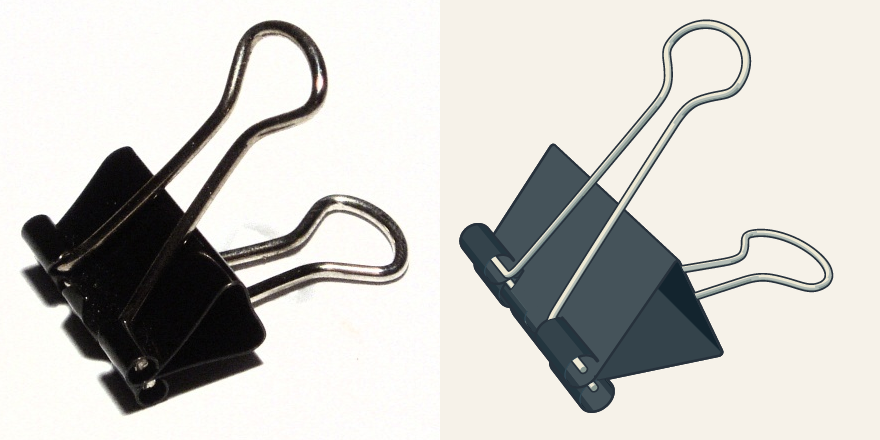

# Agent Workflow Skills

[中文说明](README.zh-CN.md) · [Examples](#real-examples) · [Install guide](docs/installation.md)

**Find the right skills, verify that they work, and retain what you learn.**

Two MIT-licensed Agent Skills for developers using Codex or another Agent Skills host.
Start with **proactive-skill-discovery**: connect capability gaps to inspected workflows,
actual task results, and maintained reusable lessons.

```sh
npx skills@1.7.4 add youchibuwan-ops/agent-workflow-skills --skill proactive-skill-discovery -a codex
```

Run from the intended project. Requires Git and Node ≥22.20.0 for this third-party CLI;
the skills themselves have no Node/Python runtime.

## Why proactive discovery?

A search result is a candidate; installation is only setup. This skill keeps the actual task in view:

1. Match installed capabilities before looking elsewhere.
2. Search for a real gap; read instructions, resources and licenses.
3. Select, thinly adapt or combine suitable workflows within the user's authorization.
4. Verify the actual output, including relevant failure cases.
5. Maintain verified decisions in an existing skill; create another only when needed.

The [discovery and learning workflow](docs/discovery-workflow.md) adds actual
artifact checks at entry, first sample, handoff and completion. Diagnose evidence,
environment, method and execution gaps separately; use new-task tests and nearby
counterexamples before promoting reusable rules.

Use it for an unfamiliar stack, repeated workflow failures, overlapping skills, or a
method worth retaining. It grants no permission to publish, spend money or resume paused work.

## Choose a skill

| Skill | Best for | Expected output |
| --- | --- | --- |
| [proactive-skill-discovery](skills/proactive-skill-discovery/SKILL.md) | Selecting, inspecting, adapting and using skills, then maintaining lessons | Chosen/rejected sources, reasons, task evidence and a scoped reusable update |
| [crafting-reference-based-svg-assets](skills/crafting-reference-based-svg-assets/SKILL.md) | Real-object SVG props with unclear proportions, thickness, connections or assembly | Editable parts, assembled SVGs, reference comparisons and bounded visual judgments |

Discovery can select the SVG workflow; SVG review does not replace discovery. Neither
is an autonomous service or a guarantee of model performance. Detailed skill instructions
currently use Chinese; this README and the usage prompts are English.

The SVG skill follows an [ordered workflow with rework gates](docs/svg-workflow.md):
references → shared structure/scale → each local's geometry, material and actual
inspection → exact assembly → a fresh whole-object review.

## Try it in Codex

After installing, start a chat in that project. If the skill is absent, restart Codex.

```text
Use $proactive-skill-discovery for this repository's release-quality audit.
Reuse existing tools, inspect candidates and licenses, verify the real install path,
and retain verified lessons. Work on a branch; do not release or submit externally.
```

Install the SVG skill separately:

```sh
npx skills@1.7.4 add youchibuwan-ops/agent-workflow-skills --skill crafting-reference-based-svg-assets -a codex
```

```text
Use $crafting-reference-based-svg-assets to make one editable binder-clip prop.
Compare reference angles, resolve the rolled edges and wire connections, finish the
difficult parts separately, then review the whole asset at its actual size.
Do not integrate it into a game.
```

SVG work needs real image inspection and an SVG editor/renderer supplied by the host.
No renderer, image generator, API key or required review model is bundled. Automatic
activation depends on the host; explicit invocation is the reproducible starting point.

## Real examples

- [Release audit and discovery](examples/discovery-release-audit/README.md): actual
  selection, OSS tool reuse, a license packaging finding, installation checks and retained learning.
- [Binder clip](examples/svg-binder-clip/README.md): licensed photographs, complementary
  angles, independent parts and native-size checks, including withdrawn approvals.
  The current r08 whole was independently reviewed and accepted by the user for public display.
- [Controlled bracket](examples/controlled-bracket/README.md): an owned vector with
  explicit planted faults, separately repaired parts and exact-group assembly checks.
- [Unseen clothespin test](examples/heldout-clothespin/README.md): actual reference
  research on a new object, with unresolved dimensional evidence kept explicit.



Photo and artwork: CC BY-SA 3.0; [credits and exceptions](examples/svg-binder-clip/ATTRIBUTION.md).
These are work examples, not no-skill/with-skill benchmarks. Future DSH variants can
use the [comparison protocol](docs/validation.md).

## Installation and compatibility

CLI 1.7.4 installs Codex project skills to `.agents/skills/<name>/`. Add `-g` for
user-wide installation. See [installation](docs/installation.md) for Windows, directory
layout, manual fallback, updates and removal. Keep the complete folder, including its license.

Codex is the install target tested here. Other Agent Skills hosts may read these
folders; cross-host behavior has not been tested. See the [validation record](docs/validation.md).

## Contribute and verify

```sh
npm ci --ignore-scripts
npm run lint
npm run verify:install
npm run render:example
```

Development dependencies serve checks/examples only. Consumers do not run `npm install`
in this repo. Schema checks reuse upstream `skills-ref`; links use lychee. CI repeats
installation on Windows and Linux. See [validation](docs/validation.md),
[contributing](CONTRIBUTING.md), [security](SECURITY.md) and [changelog](CHANGELOG.md).

## License

Skills, scripts and documentation: [MIT](LICENSE), © 2026 youchibuwan-ops.
Example photographs and derivative SVGs use the explicit licenses beside them.
Optional upstream tools are not bundled; their licenses remain their own.
