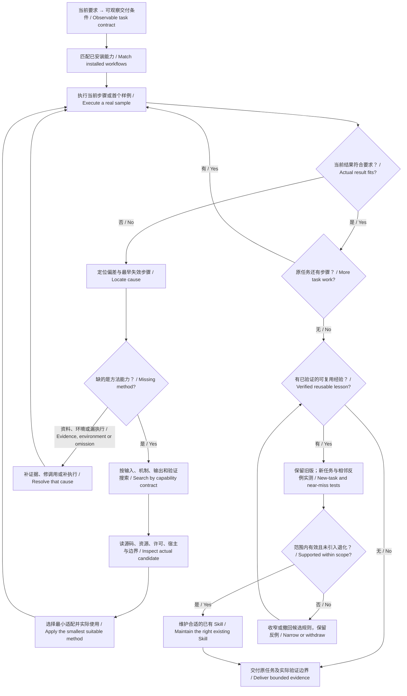

# Discovery and learning / 主动发现与学习流程

Use [proactive-skill-discovery](../skills/proactive-skill-discovery/SKILL.md).
The purpose is a correct task result and useful maintained guidance, not more
searches, installations, logs or rules.

At entry, first sample, stage handoff and completion, compare actual artifacts with
the contract and affected retained work. Diagnose a first unexplained mismatch;
do not wait for the user or mistake an omitted step for a missing Skill.
Critical unresolved gaps remain unresolved. Seek the minimum missing evidence or
input and continue independent work; neither endless searching nor an invented
pass closes the gap. User stopping points remain authoritative.

开始、首个样例、阶段交接和完成前主动对照产物。先诊断，再决定是否需要搜索；
已经有检查步骤却没有执行，就补执行、修正并重验。资料/环境/方法缺口分别处理，
查到或装上不等于用上，用上也不等于原任务完成。经验记录区分事实、解释和规则；
同一测试两版都通过就记平局，不把换一种写法说成提升。

## Research and reuse decisions — 2026-10-23

These sources informed our adaptation. Their results do not establish this
repository's efficacy, and the papers' benchmarks were not rerun here.

| Primary source actually inspected | Adopted idea / boundary |
| --- | --- |
| [Reflexion v4](https://arxiv.org/abs/2303.11366v4) | Feedback and episodic textual guidance can support later attempts without weight updates. Our adaptation uses concrete task evidence rather than treating reflection itself as verification |
| [Intrinsic self-correction study v2](https://arxiv.org/abs/2310.01798v2) | Its reasoning experiments caution against correction without external feedback; this is not a claim that every present model or task behaves identically |
| [Voyager v2](https://arxiv.org/abs/2305.16291v2) | Executable skill reuse with environment/execution feedback; Minecraft results do not prove generic workflow reliability |
| [SkillsBench v4](https://arxiv.org/html/2602.12670v4) | Paired task verification and applicability/fallback boundaries; its trajectory audit identifies heavyweight or mismatched recipes as failure modes. Keep the workflow focused |
| [SkillForgeBench](https://arxiv.org/abs/2610.14918) | Assess procedural requirements separately from an apparently correct final answer; our small tests are not that benchmark |
| [Anthropic skill-creator](https://github.com/anthropics/skills/tree/dbd4588f9e1033efb41dad4bef2f7947c8993d44/skills/skill-creator), Apache-2.0 | Inspect task outputs and baselines in fresh contexts. Its `run_eval.py` measures a Claude description-trigger proxy, not Codex task quality; no unchanged runner or automatic activation result is claimed |
| [kulaxyz self-learning](https://github.com/kulaxyz/self-learning-skills/tree/1304fce375b5d4c4508cab9eea05bbb8b95c38f6), MIT | Preserve verified procedures and useful rejected paths; prefer the existing appropriate Skill. Its task-stopping default is not adopted into this continuous task |
| [pskoett self-improving-agent](https://github.com/pskoett/self-improving-agent/tree/e958afb5bf697c7d22898f9bba53406e2e3261bd) | Read as a candidate: OpenClaw logging/maintenance, not a Codex activation runner. No license file was identified in that checked tree; it was not copied or installed |

Actual CLI queries included `skill discovery` and `self improving`, using Skills CLI
1.7.4 with telemetry disabled. Search titles/popularity were leads, not acceptance
criteria. Existing installed workflows and standard-library tools were sufficient
for the execution fixture. No additional learning service, hook, account or runtime
was introduced. The [execution evidence](validation.md#discovery-and-learning-execution)
separates actual artifacts, source/interface checks and hypothetical decisions.
