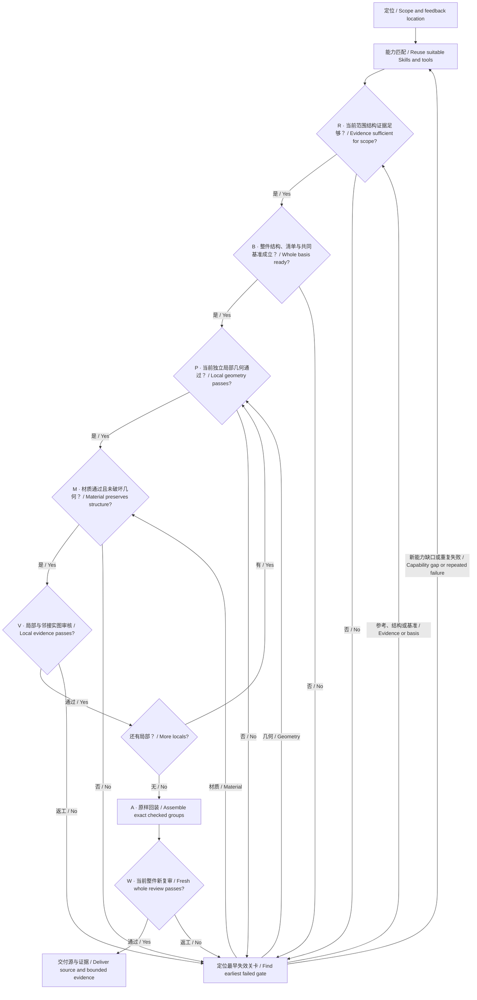

# SVG workflow / 实物 SVG 工作流程

Use the [Skill](../skills/crafting-reference-based-svg-assets/SKILL.md) for execution.
This diagram explains its stage order; arrows represent evidence-based decisions,
not permission to mark unchecked stages complete.

Within R, sparse evidence follows **observations → competing explanations → test
known structural constraints → seek discriminating evidence if needed**. Stop
searching when the current delivery is supported. If a critical ambiguity remains
and evidence is unavailable, record the minimum missing input or assumption choice;
continue independent work. This records a blocker, never a passed R gate.

Before each transition, inspect the actual current artifacts and record:
**version/local → action and output → reference position and observation → remaining
required corrections → next action**. A missing prerequisite blocks that arrow.
Rework includes regenerating and opening the new image; a stale screenshot or
copied pass cannot close a gate. If a render is stale, regenerate and inspect it
before deciding which stage failed.

Match installed Skills at entry. For a new capability gap or repeated failure,
use `proactive-skill-discovery` when available to inspect suitable existing
workflows before adding implementation. Check the helper's actual geometry and
audit limits; an isometric convex-solid helper or bounding-box test cannot prove
an open, nonconvex sheet correct. Reuse a verified workflow for routine edits.

开始先匹配已有 Skill；新专业缺口或同类反复失败时，先用主动发现流程查现成能力，
读源码、许可和适用边界，再薄适配并实际验证。查了/装了不等于应用，更不等于过关；
这条返工分流不会跳过当前局部的几何、材质和实图审核。

每个箭头都要核当前事实：**版本/局部 → 实际动作及产物 → 参考位置和观察 →
剩余必改 → 下一动作**。缺适用步骤、关键证据或仍有必改，就留在最早未满足关卡。
独立局部须有保留共同坐标的可编辑源，并实际看局部及邻接；只在整图上改一处、
截一张整图不能代替。全部局部完成后才回装，局部通过不能替整件通过。

References close a loop: **question → visible evidence and rejected explanations →
geometry/retention decision → actual reinspection**. For each critical local,
check longitudinal spans and transverse extent separately, including openings and
occlusion. Compare the same construction at applicable real-reference angles;
rotating a model alone adds no real-object evidence. Different specimens can
constrain common relationships without supplying interchangeable exact dimensions.
Assign reference roles per part and question. A body-dimension reference may not
resolve a handle's depth. Before modeling a spatial bend, find views that actually
distinguish it from a tilted planar construction; one-view fitting cannot do so.
Sparse evidence triggers bounded hypothesis testing, not a quota of pictures:
extract observations, test alternatives against continuity, interfaces, dimensions
and motion, then seek only the missing discriminating evidence. Keep noncritical
hidden assumptions explicit. Unresolved critical ambiguity blocks affected geometry;
report the minimum missing input and continue independent work without endless search.

参考必须形成闭环：**待判问题 → 实图依据与排除解释 → 几何修改/保留 → 同位置复看**。
长向分段、横向展开/截面、缺口和遮挡分别核；同一结构转到实际参考视角后同比对照，
不能只对齐一条轴或转几个模型角度就放行。异款比例用于排除误读，精确尺寸不能直接移植。
参考角色必须落实到部件和待判量，主体尺寸主图不自动成为手柄结构主图。先用适用
证据排除共面投影和空间弯折的歧义，不能先猜平面再靠单角度拟合自证。
资料少时依次提取确定约束、检验少量候选、只补能区分候选的证据；不凑图数，
也不机械要求三视图。非关键隐藏量可保留明确假设；关键歧义未解不能放行相关几何，
应列最小缺口并完成不受它影响的工作，不能无限搜索或假装确定。

Audit coverage and formation first, then shared dimensions/projection, continuity,
material and native-size readability. An earlier failure limits later observations;
reviewer agreement, source hashes and successful rendering do not establish visual
quality. Preserve failed iterations and test changed instructions through real actions.

先审实例覆盖与形成路径，再审共同尺寸/投影、连续接触、材质及用途尺寸。前项失败，
后项不能汇总成通过。保留失败；修规则后实际执行测试，不以复述规则验收。
有必改继续返工；用户暂停、确实需要输入/授权或外部资源时准确保留未完成状态。

See the [case record](../examples/svg-binder-clip/execution-record.md) and
[validation scopes](validation.md). The binder clip remains under rework;
this diagram does not assert that the example passed.
