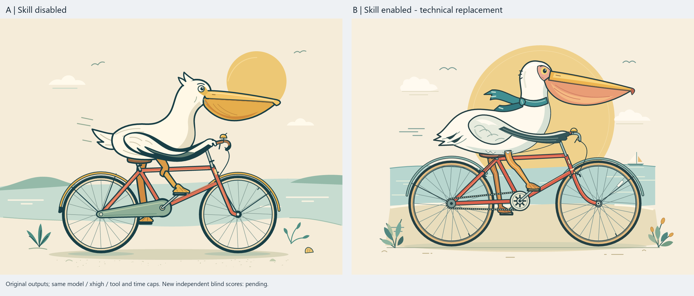

# 鹈鹕骑自行车：质量、自主检查与时间成本

[English / 完整方法与边界](README.md) · [离线演示](demo.html) · [过程证据](process.md)

这两轮作者 A/B 的关注点是：**让代理自己查参考、检查连接和遮挡、发现并修正问题，
把更多精力投入成品质量，减少用户逐处提醒的负担。** 两组作品都公开，供读者直接比较。
这是项目的价值方向；本次没有测出“节省了多少提醒”或普遍质量提升率。

A 不启用目标 Skill；B 只安装预发布版 `crafting-reference-based-svg-assets`，固定到
`d8a81d9f0c46c94f2c8ccb904da0514377a8573c`。提示词没有显式调用 Skill。
两轮 B 都实际读取了 Skill。**这不是 proactive-skill-discovery 的效果实验**；
主动发现的完整链有[独立的验收记录](../../docs/codex-acceptance.md)。

## 原始作品与演示

[A SVG](v1/results/A.svg) · [B SVG](v1/results/B.svg) ·
[误停旧 B，保留但排除](v1/results/B-interrupted.svg)

本轮非盲观察：B 的牙盘/链条、翅膀羽毛和喉囊明暗更明确，A 则采用较简洁的链罩表达，
同样形成了可辨认的完整插图。细节多不自动等于结构正确。用户认可作品质量，
但当前最终配对没有适用的独立盲评分。

**动画 B 在预算截止前保存了可播放作品，但没有正常完成主任务，不能记作完整验收通过。**

[12 秒对照录像](animated-v1/results/comparison.mp4) ·
[WebM 兼容版本](animated-v1/results/comparison.webm) ·
[A 原始 HTML](animated-v1/results/A.html) · [B 原始 HTML](animated-v1/results/B.html)

下载 HTML 后用浏览器打开，或克隆仓库后打开 `demo.html`。GitHub 文件页只展示源码。
离线演示可暂停录像、分别查看两组原始动画，不调用模型、不消耗模型额度。
两组均有车轮旋转、脚踏运动和腿部关节运动；抽查接触图中脚与踏板、翅膀与车把保持连接。
B 的传动与前叉制动细节更明确。这是非盲、抽样观察，不能替代整个周期的运动学验证。

## 同样上限，实际成本不同

两轮均为 Codex CLI 0.155.1、**gpt-6-astra / xhigh（极高）**。
每轮内部任务、工具、权限相同，每组上限 **900 秒 / 80 次登记的基础工具启动**。

| 轮次与组别 | 实际秒数 | 工具启动 | 检索 / 看图 | 主任务状态 |
| --- | ---: | ---: | ---: | --- |
| 静态 A | 458.16 | 12 | 0 / 3 | 正常结束；不等于独立质量验收 |
| 静态 B，技术补跑 | 567.76 | 34 | 2 / 14 | 正常结束；独立复审未完成 |
| 动画 A | 519.18 | 22 | 0 / 10 | 正常结束；不等于独立质量验收 |
| 动画 B | 900.09 | 55 | 2 / 27 | 预算耗尽；未观察到主任务完成 |

静态 B 多用 109.60 秒；动画 B 用满时间，额外 0.09 秒来自停止和日志收尾。
不推测继续运行后多久完成，也不把更多调用次数当作质量分。
[原生 token 计数](usage.json)区分输入、缓存输入和输出，累计包含反复输入，
并非费用账单或额度百分比；缓存输入已包含在输入内，推理输出已包含在输出内。
同预算上限不等于同实际消耗，没有 token/金额硬上限。该表仅覆盖最终四个执行者，
不包含误停旧 B、旧评审和项目整理的全部成本。

## 自主纠错的证据与限制

最终展示的两组运行期间都没有人工逐步纠正，协调者也没有修改作品。
B 自己读取工作流、查参考、看局部和整体，并记录了坐垫、脚踏遮挡、膝部和制动连接的
纠正过程；A 同样主动检查和修正。见[双方可见过程摘录](process.md)。

因此可以展示“无需逐处提醒，也能执行较细致的研究和检查”，但不能说本次已经证明
比 A 减少了提醒：**双方收到的纠正提醒均为零**。还需预先固定人工介入策略和同一质量
目标，才能量化提醒负担。用户“效果相当不错”的评价属于用户反馈，未替代盲审或更改标准。

静态旧 B 在 711.26 秒 / 33 次工具启动时被测试器误停，原因是把子线程完成当成主线程
完成。原文件、错误和修正前记录保留；只获授权补跑一次 B，A 未重跑，实际顺序为旧 B→A→新 B。
旧两份盲评只适用于旧配对，不移用到新 B 或动画。静态双方各有两次命令非零退出，
B 的内部独立审阅启动也失败，未伪装成通过。

动画先用零生成调用检查测试器、隔离环境和录制，再按 A→B 各运行一次。
此次 B 是真实预算截止，没有误停、重跑或延时。每组独立空目录/会话，目标 Skill
以外保持相同；实际 MCP/apps 为空，前后目录/文件摘要核对。后台插件缓存可能下载，
提供商与网络缓存不可控，不声称绝对隔离。

两份动画在 Chromium 141.0.7390.37 离线录制约 12.5 秒，采样 13 帧，未观察到页面错误、
控制台错误或被拦截的联网请求。保留实际采样时间，不能当成精确寻帧；未验证跨浏览器、
全周期接触与严格无缝。视频两侧均剪去相同的起始 0.3 秒，GIF 为缩小的 6 秒预览，未改速。

每个任务只有一组最终配对、顺序固定、模型输出随机且协调者知晓组别。
**不宣称统计胜率、普遍因果效果、最终独立盲审已通过或更省时。** 冻结提示词、规则、
原件、摘要、失败、成本与脱敏事件索引可在目录内核对；完整 RPC/草稿/原录像保留在私有
实验档案，未公开隐藏推理、账户信息或参考照片。索引不等于完整可独立复核的原始过程。

新鹈鹕作品及其录像采用仓库 [MIT 许可](../../LICENSE)，与长尾夹照片的许可分开。
复现环境要求和全部证据入口见[英文完整记录](README.md#reproduce-and-reuse)。
本次整理另做[文件与演示核验](packaging-checks.md)，并提供 [SHA256SUMS](SHA256SUMS)。
