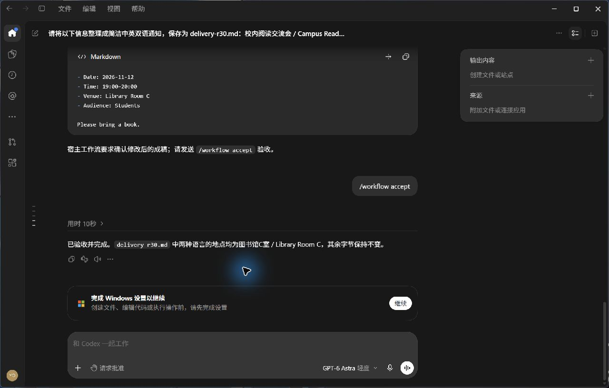
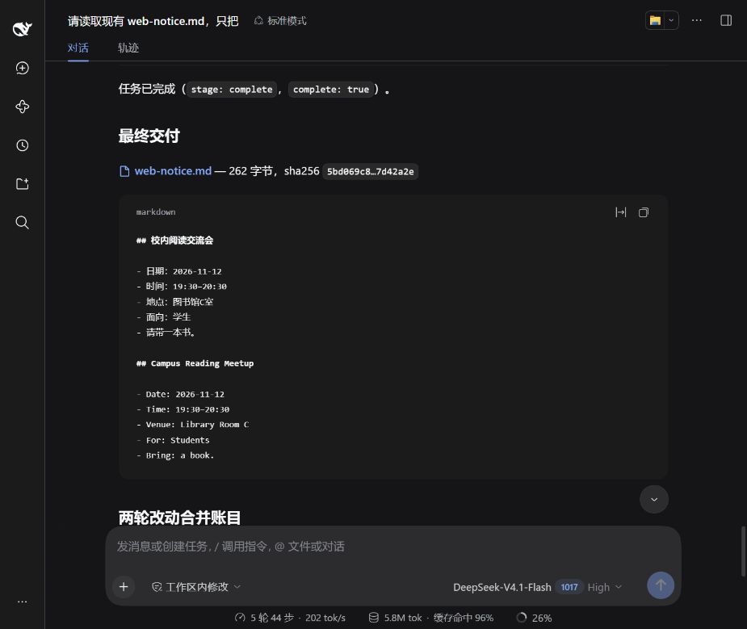

# R30：实际 Codex 桌面与 DSH Web 验收

这是作者本机的当前源码实测，独立代理做了另外的定向复核；**不是第三方签名或同学电脑的复现结果**。本页不把旧版本通过移到新代码。

- 版本：`20261026-preview3-r30`。
- payload manifest SHA256：`c1620d7674122dfb90be51d83467c651480b28e58a78cec1c3f26b2c05185fd1`，132 个发行文件。
- [完整结果与边界](summary.json)、[发行源码清单](source-manifest.json)、[能力引入与经验维护](capability-and-learning.md)、[保留的失败](failures.md)。

## 实际做过的验证

| 检查 | 结果 | 能证明的范围 |
| --- | --- | --- |
| 完整 global 回归，真实原生 SDK、OS sandbox 和公网来源开关开启 | 426/426，零失败、零跳过 | 本机当前 131 个仓库源文件测试前后相同 |
| 打包、Node/依赖封存、固定原生入口 | 33/33，零跳过 | 构建和拒绝反例；不等于同学已经安装 |
| Codex 旧策略回归 | 31/31，零跳过 | 既有策略没有被这次变更放宽 |
| Skill 分发与阶段门禁 | 29/29，零跳过 | 官方发现/加载、拒绝覆盖和阶段拒绝行为 |
| [实际 Codex GUI](codex.json) | 5 回合、59 次工具调用、修订 2 完成 | 先研究和选择，再写初稿；反馈重新核查与选择；只改两处地点；验收和学习 |
| [实际默认入口 DSH Web](web.json) | 5 回合、70 次工具调用、修订 2 完成 | 首次目标已存在；两回合原生写入；只改两处地点和两处时间，其他字节相同 |
| [DSH SDK 真实模型](dsh-sdk.json) | 27 次提供器请求、3 回合完成 | 早写被拒，真实选择后写入；原件 BOM/CRLF 未改，输出符合声明的 CRLF；首稿评分即通过 |
| 最终安装核验 | 132 个 payload 文件及完整 Node/SDK/私有桌面树通过 | 所有扩展名均复核；发行源码、已装依赖和快捷方式分开核验 |

DSH Web 的实际请求头全部为 `maxTokens: 100000`。这是**每次回复上限**，不表示一次必须输出这么多，也不表示总任务预算。SDK 付费探针实际用量保留在 JSON；JSON 输入字节、缓存 token、输出 token 和金额不能混算。

SDK 的首稿保留了两句关于写作要求的多余说明。其事件事实和格式检查通过，**不把它称为编辑质量验收**。反馈修订由另外两条实际 GUI/Web 链验证。

## 实物与截图

Codex 的 [初稿](artifacts/codex-before.md.txt) 与 [终稿](artifacts/codex-final.md.txt) 均为 269 字节，只把两处 A 改成 C；上一轮完成的文件摘要未变。



Web 的 [原件](artifacts/web-before.md.txt)、[第一次修改](artifacts/web-first.md.txt)、[最终文件](artifacts/web-final.md.txt) 均为 262 字节：第一次恰为两个 `0x41→0x43`，第二次恰为四个 `0x30→0x33`。原始截图未经裁剪或修改。原始 Markdown 快照以 `.md.txt` 保存，保留模型实际字节；不为通过文档排版检查重写它们。



两条会话的验收命令由作者测试驱动通过真实界面提交。它们不是用户对游戏、美术或文案的审美认可。Codex 的 Windows 设置提示保留在截图中，本次没有点击它或调整系统安全设置。

## 同学怎么用

从 [Releases](https://github.com/youchibuwan-ops/agent-workflow-skills/releases) 下载本版 DSH ZIP，完整解压后运行 `安装DSH.cmd`，再运行 `启用默认DSH.cmd`，**重开终端**。设置自己的 `DEEPSEEK_API_KEY`，进入项目后运行 `dsh web`；手动打开本机网址，再在 Web 中添加并选择正确项目目录。不要把包发给 DeepSeek 网页要求它自行接管。

本机默认命令用注册表 Machine+User PATH 的新进程实际检查，`where dsh` 和 `Get-Command dsh` 首项均为受控 alias；没有临时强行 prepend 后冒充默认化。

本机 Codex 通过 `Codex-Controlled` 快捷方式使用受控私有桌面；DSH 安装按钮不分发 Codex 厂商程序。旧 stock Codex、这个根聊天、DeepSeek 网页和绕开入口的 SDK 不会被追溯接管。受控入口拒绝未纳管的工具和路由；缺视觉、方法执行或 Skill 行为校验能力时应阻断，不能保证任意任务质量。

## 复核

在本仓库根目录、Node 24.22.1 下运行：

```sh
node evidence/global-entry-r30-20261026/verify-evidence.mjs
npm run test:global
npm run test:global-package
```

第一个命令核查当前源码与冻结清单、证据文件摘要及独立定义的字节修改。它验证公开记录的一致性，不能凭这些静态文件重新证明模型确实运行过。真实模型探针需自己的密钥、受控安装和新 dry-run；真实 GUI 需本机适配，不能用离线评分器冒充。

本机完整回归显式启用了原生、sandbox 与公网前提。GitHub CI 的 Windows/Linux、缺失能力拒绝和历史版本各自有不同范围，不能套用这里的零跳过数字。
