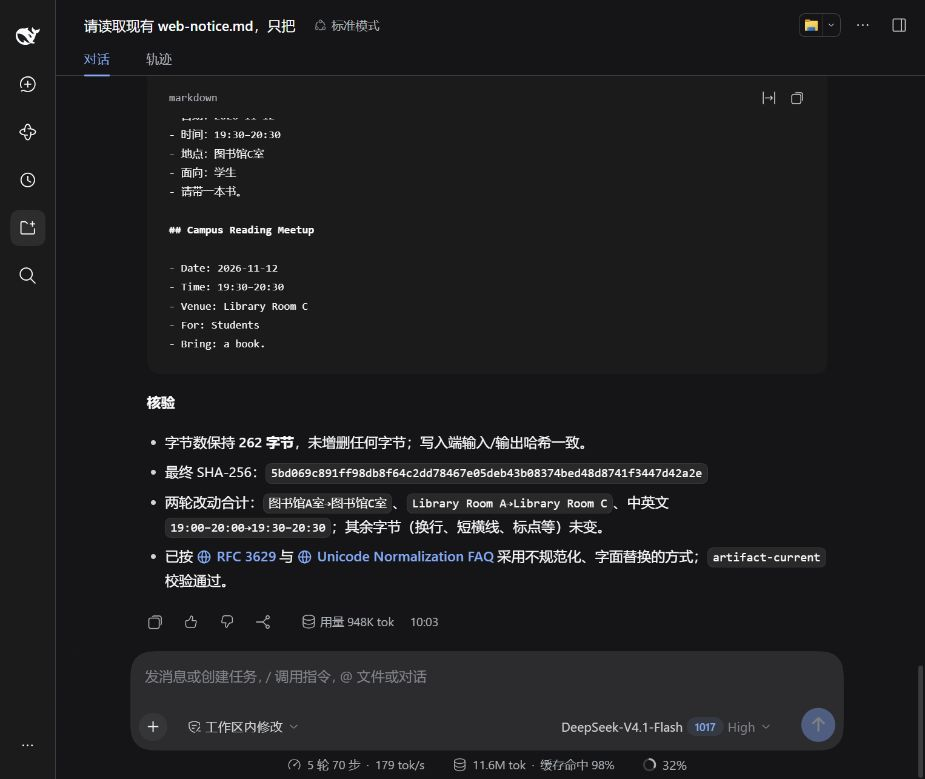

# R32 交付核验记录 — 2026-10-26

本记录覆盖已安装的最终受控入口和 DSH Windows x64 安装包。真实模型与界面操作是作者驱动的实测，不能冒称第三方独立验收。

## 当前产物与真实行为身份

- 最终 R32 manifest：`b4780e84c1749013f4ce25dbfd4d83eaf21590456f40d2e24d22dca20bb3c6e3`，132 个发行文件。
- 三条真实行为链保留 R31 manifest：`7fd4745e6cf459b31091d1896362792eac8235288a23ed42ec767bb5e3956370`。
- 两版仅有核心测试及两份 `stage-checks.md` 不同；全部生产执行代码相同。R32 实际更新两个个人 Skill、固定配置和默认启动器，重新打开双端历史并核验完整源码与已安装依赖树。没有把旧付费记录改成新版本记录。

| 实测 | 结果与边界 |
| --- | --- |
| Codex 私有桌面 / gpt-6-astra | 5 轮、59 次工具、9 次拒绝、2 次成功写入；三方案选择、反馈、再选择、验收、学习全部完成 |
| 默认入口 DSH Web / DeepSeek-V4.1-Flash | 5 轮、88 次工具、16 次拒绝；已有文件连续两次精确修改，独立比对其余字节不变 |
| DSH SDK 真实模型 | 21 次提供器请求、3 轮、首稿通过；551 字节、10 个 CRLF、无 BOM；每次回复上限 100000 token |
| R32 本地全量回归 | 426 项中 425 通过，唯一网络请求返回 403；原失败保留，额度重置后对原网络集成用例单独复验，结果见 summary |
| R32 安装包 / Codex 策略 | 34/34、31/31，均零跳过 |

模型自行声称的行数没有作为标准答案。实际 Web 原文件是 15 行；其方案里“17 行”是错误叙述。验收依据独立原始字节和成功调用与返回的对应关系，不以模型解释替代验证。

## 安装与覆盖

下载 [preview.3 发行版](https://github.com/youchibuwan-ops/agent-workflow-skills/releases/tag/v0.2.0-host-preview.3)，完整解压后运行 `安装DSH.cmd`，再运行 `启用默认DSH.cmd`，重新打开终端，设置自己的密钥并执行 `dsh web`。先在网页选对实际工作区。详见[安装步骤](../../docs/global-entry.md)。

本机 Codex 从 `Codex-Controlled` 进入，DSH 从已启用的默认 `dsh` 进入。原版当前聊天、DeepSeek 网站、任意直接加载的 SDK 不会被追溯接管。安装包不含私有 Codex 应用、账号或密钥。

宿主阻断被管理的工具路径跳步，不保证模型每句解释正确、所有视觉质量或任意领域任务结果。通用运行时默认只能核有依据的“不增补经验”；需要真正修改 Skill 时，缺可信行为验证器就阻断，不能自填通过。

## 可复核证据

[完整摘要](summary.json)、[Codex](codex.json)、[Web](web.json)、[SDK](dsh-sdk.json) 保留源身份与结果；`artifacts/` 的 `.md.txt` 是实际文件原始字节，未为排版润色。完成图及最终冷启动图保留，私有历史、凭据及不透明登录网址不发布。

```sh
node evidence/global-entry-r32-20261026/verify-evidence.mjs
node evidence/global-entry-r32-20261026/verify-evidence.mjs /absolute/path/to/installer.zip
```

这是当前源码、公开记录与 ZIP 的一致性检查，不会重新执行历史模型或 GUI。历史 R30 的检验脚本应在其固定提交运行，不能拿当前源码冒充旧版相同。

## 能力引入与经验落实

实际引入官方 `dotnet/skills` 的 `dotnet-pinvoke`（提交 `a6bf43ab61967c30919334986515163ab24d7635`，MIT，四个文件完整核读并安装），用于原生 ABI、字符串和资源所有权。COM 不在该 Skill 覆盖内，另查 Microsoft 的 IShellLinkW 完整接口和 IPersistFile 文档，实际非 ANSI 路径反例、Windows CI 与快捷方式读回验证 Unicode 修复。`vercel/eve` 的 technical-writing 含内部环境假设，核读九个文件及 NOTICE 后拒绝安装。

两版主动发现 Skill 均已维护 `references/stage-checks.md`：保留实际来源、原生权限、首次失败原因、换行物化及跨 Agent 观察基线的经验；本轮新增“反例前提必须实际发生且在处理器外核对”。三个行为对照分别确认真实状态变化通过、第一次变化不可观测失败、第二次变化不可观测失败；最后一种即便宿主返回 fatal 也不能冒充测试成功。两份个人安装各 10 文件读回与冻结来源完全一致。

## 失败保留与未覆盖项

- R26 曾全绿，但独立审查仍找出身份边界问题；未部署它。R27 的元数据失败、R28 Web 已有文件写入失败及其修复均保留在私有原始记录与历史公开证据中。
- R30 CI 暴露测试 PATH 缺锁定 pnpm 和非 ANSI ShellLink 错误；后续 Windows/Linux CI 验证修复。Linux 官方 headless 不提供原生 pwsh 正向能力，正向测试移到 Windows 原生套件，Linux 明确拒绝用例保留。
- R31 Windows CI 的不稳定状态反例未记录当时元数据，确切底层原因未知；本机旧算法 100 次没有复现。R32 加强夹具前提，不删 fatal、双读或无交付断言，不加跳过。
- R32 首次 DSH 规则同步未运行生成器，结构检查以 28/29 拒绝；实际生成后 29/29。首次完整性终验与版本切换并行导致旧 R31 终验拒绝混合版本，没有记为通过；最终 R32 独立终验通过。
- 匿名 GitHub 配额耗尽的 403 原失败保留。后续同生产请求独立观察到 core 60/60、remaining 0；不是根据旧堆栈倒猜端点。
- WSL 原生 Python `E_ACCESSDENIED`、SDK-minimal 持续终端、二进制/视觉检查仍是明确边界。R29 清理 EPERM 的锁定来源未知。发行与依赖完整性不等于第三方签名、通用语义正确性或审美验收。


