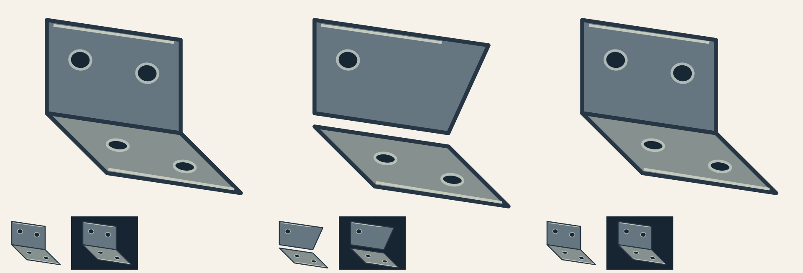

# Controlled SVG workflow regression case

This is an owned, exact-vector reference and deliberately injected defects, not a
photographic reconstruction, an aesthetic benchmark or a claimed natural before/after.
All files in this directory are MIT-licensed, © 2026 youchibuwan-ops.

## Reproduce the task

Give an independent agent the SVG skill plus `reference.svg`, `faulty.svg` and the
request below. Do not show the defect list or earlier review before it executes:

> Review this editable folded bracket at 160px width against the exact owned
> reference. Inspect the current source and each physical panel, then the whole
> outline, repeated features and common fold. A supplied preview may need version
> verification. Give specific defects and return stages; do not alter the input
> or seek a replacement reference for already exact geometry.

The private execution also supplied a preview rendered from the reference rather
than the faulty source. The agent independently rendered the current source and
rejected that preview as evidence for it. The published sheet is explicitly labeled
by column here, so it is an explanation rather than a blind evaluation input.

## Injected defects and actual repair

- `faulty.svg`: upright top-right endpoint moved from `(155,40)` to `(185,44)`;
  the right edge becomes slanted. A shortened decoration line cannot repair it.
- The upright's second hole at `(130,65)` was removed; one instance does not
  validate the required pair.
- The base group was translated down 10 source units. Its local shape still
  resembles the reference, while the continuous sheet's fold becomes a gap.

Root repaired the upright's geometry and missing instance, rendered and actually
viewed it enlarged and at 160px on light/dark backgrounds; then repaired and viewed
the base, retaining its correct geometry. The two current groups were assembled
unchanged into `source.svg` and the complete current figure was rendered and viewed.
The reference is exact owned vector data, so those coordinates are binding here;
this permission does not transfer to approximate photograph landmarks.



Columns: reference, injected faults, repaired assembly. Lower rows are the actual
160px versions on light/dark backgrounds. Generate from these sources with:

```sh
npm ci --ignore-scripts
npm run render:example
```

This bounded case exercises geometry versus highlight, repeated-instance coverage,
local-to-whole continuity, stale-output rejection and repair/review sequencing.
It does not test reference search, photo reconstruction or user aesthetic acceptance.
See the [validation record](../../docs/validation.md) for execution versions and limits.
