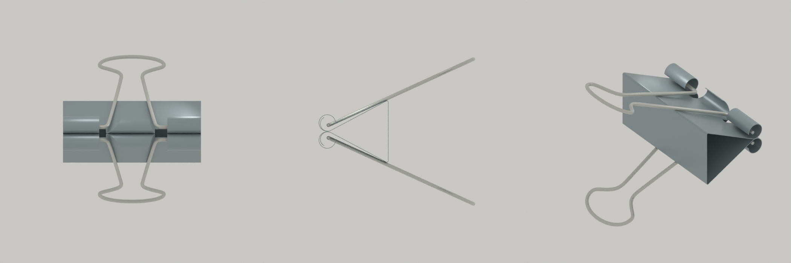
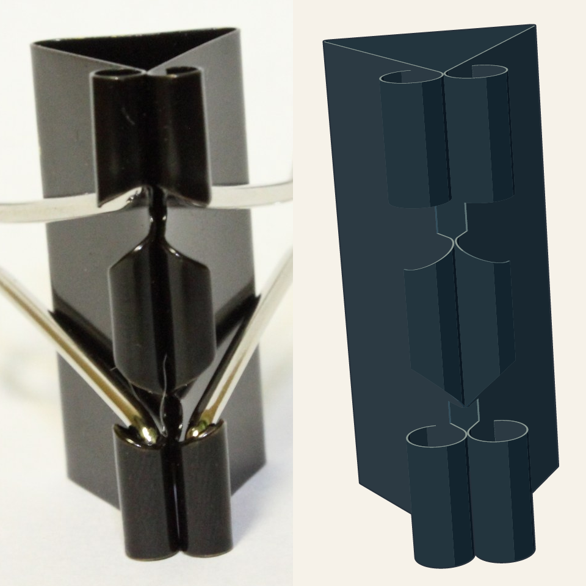
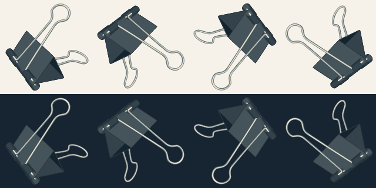

# Binder clip: reference, construction and editable SVG

One real iterative task: a transparent, editable 160×160 prop. The photographs,
rejected drafts and current construction are actual artifacts from the work.
This is not a no-skill/with-skill benchmark.

Current r08 passed a fresh whole-object static review and was explicitly accepted
by the user for public display on 2026-10-23.


Left: Richard Wheeler's photograph. Right: current SVG, aligned by one global
rotation, translation and uniform scale. The photograph supplies pose and complete
handles; its body is a different specimen from the selected dimensional reference.
It is not a fabricated “before” image or an exact silhouette target for that body.

## What the references establish

| Reference | Used to answer | Limit |
| --- | --- | --- |
| [Clear mouth photograph](support-axial.jpg) | Selected BODY proportions, four outer rolls, two central returning lips, relative end/root/free-edge spans | Perspective and occlusion remain; not an orthographic drawing or a ruler for intrinsic handle shape |
| [Complete oblique photograph](reference.jpg) | Target pose, complete U handles, projected legs and occlusion | Different body specimen; exact body dimensions are not transferred |
| [Black clip](support-black.jpg) | Coated sheet, complete raised handles and attachment relationships | Different specimen and illumination |
| [Unpainted clip](support-unpainted.jpg) | Continuous folded sheet, returning edges and wire interfaces under different reflectance | Not the coating-color reference |
| [Multiple views](support-views.jpg) | End-section, broad face, slots and opposing curl formation | Different sizes/poses are not interchangeable measurements |
| [Clips with/without handles](support-no-handles.jpg) | Exposed mouth, both reliefs and central sheet continuity | Common topology only |

Each photograph was actually opened. Overlapping stacks and a differently operating
wire clamp were rejected. A MAUL 21532 manufacturer front/side drawing was also
inspected for complementary handle/hinge relationships; its different specification
was not used as an exact dimensional source. [Credits and licenses](ATTRIBUTION.md).

## Structure before appearance

The construction has **one continuous folded sheet**, with four outer C-shaped
bearing rolls and two central returning lips. Each opposing curl was traced from
its own sheet root through the curved wall to its open free edge. Four entry
reliefs remain. Two continuous U-shaped wires supply four legs and bent pin ends;
an exposed terminal is part of that wire, not a separately added bright dot.
The dark footprint in the photograph is cast shadow and is excluded from the prop.

The shared [construction.blend](construction.blend) preserves the sheet, common
editable handle guide, two rigid handle instances and cameras. It is an optional
spatial construction aid, not a runtime dependency or an engineering scan.



These are model cameras, not additional photographs. The end view combines
different positions along the width; it is not one unique cross-section.



Same crop and camera on both BODY columns; no independent X/Y stretching or camera
refit between revisions. Handles are omitted from the construction column because
the mouth photograph uses a different handle configuration. The far central upper
endpoint retains approximately 20px residual at the original 1920×1280 photo size.
Hidden roots/roll angles are bounded construction assumptions, not exact measurements.

## Reproduce the artifact checks

From the repository root, with Node ≥22.20.0:

```sh
npm ci --ignore-scripts
npm run assemble:example
npm run render:example
```

Assembly reads the current [local SVGs](locals/N-wire.svg) in their shared coordinates and
checks all four outer-roll and both central-lip instances. It preserves the exact
local groups; changing an actual part requires renewed visual review.
[case-manifest.json](case-manifest.json) binds source/model/groups;
[render-manifest.json](render-manifest.json) binds generated images. These integrity
checks cannot judge geometry or appearance.



Rows: light/dark. Columns: 0°, 90°, 180°, 270°. These are screen rotations, not
additional camera views. The separate construction views use the same actual model.

The [execution record](execution-record.md) explains the per-local geometry,
material, adjacency and whole-object reviews, including failures and corrective loops.
The genuine rejected [before.svg](before.svg) and
[assembly seam crop](assembly-seam-rejected.png) are historical failure evidence;
neither is a controlled baseline. No game integration, mechanical-load test or
general agent-reliability improvement is claimed.

中文：先厘清同一片材的六处卷折和两根完整手柄，再在共同基准中逐局部制作、
核材质与邻接、原样回装，最后重新审核整件。照片、模型多视图、格式检查和用户
审美认可各有不同作用，不能互相冒充。当前 r08 已获用户同意作为公开案例展示。
