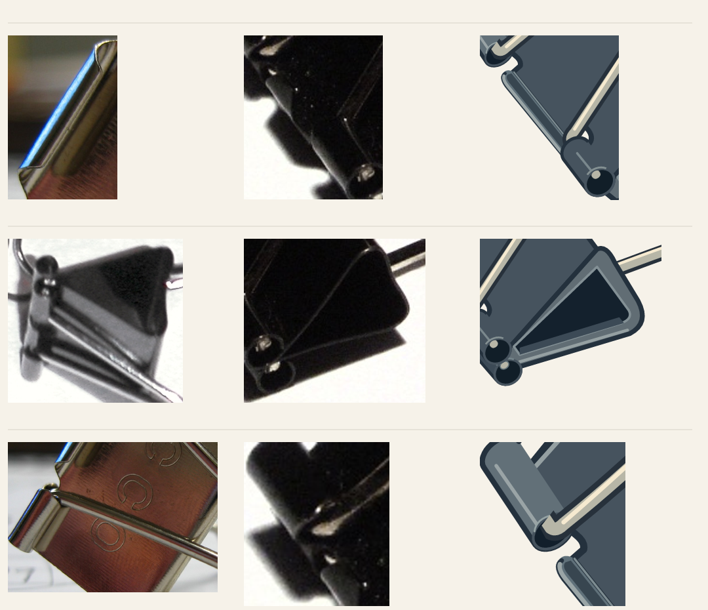
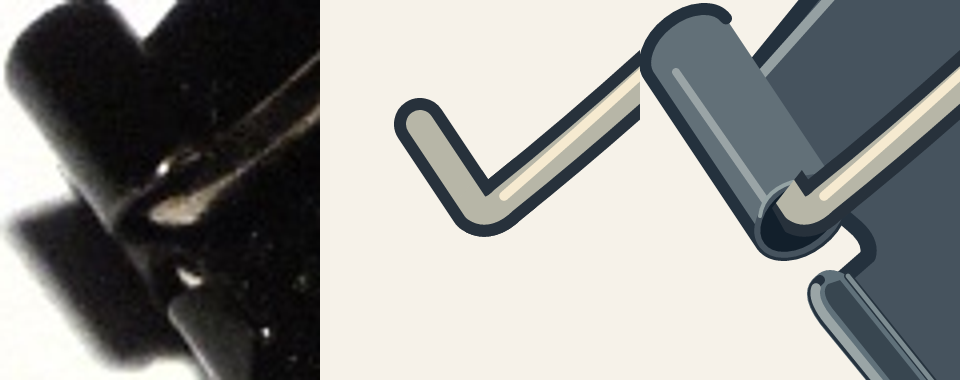
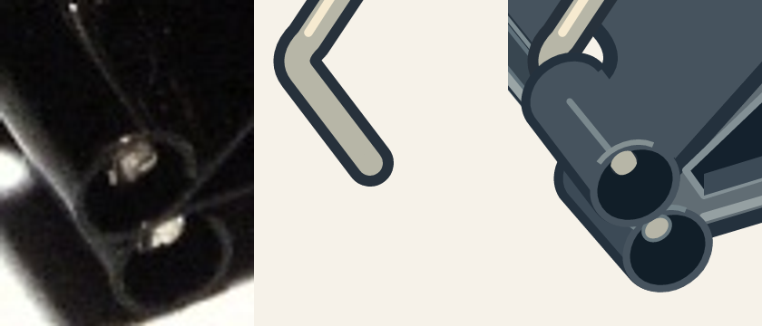

# Real case: binder-clip reference review and editable SVG

Target: one stylized **oblique** clip, transparent editable SVG, 160×160 native canvas.
No game integration, generated imagery or engineering reconstruction is claimed.
This is an actual iterative example, including errors; it is not a performance benchmark.

## References and what each can establish

| File | Actual observation and role | Boundary |
| --- | --- | --- |
| `reference.jpg` | Richard Wheeler's complete oblique clip; target silhouette, handle projections and relative locations | Dark paint hides parts of the mouth; not an orthographic ruler |
| `support-black.jpg` | HenryLi's black clip, broad-face oblique; sheet continuity and raised wire legs | Different specimen/size, not a source of target proportions |
| `support-unpainted.jpg` | Prosavage2600's unpainted folded clip; rolled sheet and wire contact under different reflectance | Different finish/specimen; not a color or silhouette reference |
| `support-no-handles.jpg` | Thaurisil's arm-up/arm-down/arm-free clips; the exposed mouth identifies two entry slots and the central continuous sheet; the metal-finish view is needed to read its raised curled section | Different specimen, topology only; not a dimensional source |
| `support-views.jpg` | Polyparadigm's set; large broad-face clip shows two mouth interruptions and central curled lip; lower-right end view shows folded cross-section | Different sizes and poses; only common visible topology is transferable |

Searches included `binder clip single`, Commons file/category searches, and candidate
angle comparisons. Each listed photo was opened as pixels. A Flickr stack was rejected
as the main reference because several clips overlap. Mauro Cateb's `Binder clip - 1`
was actually opened but rejected: it is a wire spring clamp, a different mechanism.
The HDR collection was viewed but rejected for local diagnosis because overlaps and
reflections obscure the required mouth detail. See [credits](ATTRIBUTION.md).

## Concrete structure, not image count

The broad-face reference shows two distinct relief/entry positions along the mouth.
The two front wire legs do not merely terminate on one unbroken rolled strip. Two
outer sleeves flank a central sheet tongue whose lip is curled; it is continuous
with the broad spring sheet, not a bolted-on flat bar. The end-view reference helps
separate folded sheet, side cavity and background shadow.

Current source uses shared coordinates for independent parts:

- `front-lever.svg`: long two-legged wire handle and its bent ends.
- `rear-lever.svg`: shorter handle, with distinct emergence positions; hidden engagement is unverified.
- `spring-body.svg`: broad folded sheet and visible side cross-section.
- `central-lip.svg`: middle tongue with bowed curled lip between the two entry reliefs.
- `rolled-sockets.svg`: far rolled sleeve and its end section.
- `left-joint-study.svg`, `right-joint-study.svg`: each mouth with neighboring sheet and visible wire ends.
- `front-mouth-study.svg`: both entry reliefs and the continuous curled tongue.
- `rear-lever-study.svg`: short handle with both distinct emergence positions.

The initial partial-local attempt failed. The current version follows the complete
[local execution record](execution-record.md), with actual independent part/context
inspections before reassembly in `source.svg`, followed by whole inspection and subsequent user corrections in the
[central rework and withdrawn whole inspection](execution-record.md#upturned-central-curl-correction).
The render script checks that assembly includes the exact current part groups. This
checks version integrity, not whether the drawing is structurally or artistically correct.

## Recorded failures and revisions

Initial work inspected only the long handle independently and advanced to assembly
too early. A dark-background fix and an independent whole review both missed more
fundamental topology. Those approvals were withdrawn after user correction.

The retained `before.svg` is a genuine rejected in-session draft. Subsequent work
removed an unsupported bottom wedge, separated dark faces, corrected a rear wire
terminal, and then rebuilt the segmented mouth after recognizing two entry reliefs.
The central lip also required revision from an attached-looking flat strip into a
continuation of the curled sheet. These are not no-skill/with-skill conditions: the
skill was already available during the failed work. Reviewer agreement was insufficient. A later proposed bottom flange was also rejected:
the dark footprint under the clip is cast shadow, not an extra plate. The current
record maps each auxiliary view to the actual geometry changed or retained; merely
opening several photos did not prevent the earlier mistaken interpretation.

## Reproduce and inspect

```sh
npm ci --ignore-scripts
npm run render:example
```


Same crop/viewBox `[260,160,440,440]`, isotropic scaling. Left is photograph, middle
is a part study, right is assembly; the photograph is not a fabricated before image.


The rows show light/dark backgrounds; columns show 0°, 90°, 180°, 270°.
These rotations test screen readability, not new camera views. `render-manifest.json`
binds current source, references and exported images. Regeneration is not visual approval.

The image set remains an illustrative static study. Hidden rear sleeve engagement,
exact dimensions, material tolerances, dynamic performance and user aesthetic
acceptance are outside the demonstrated evidence. Failed earlier reviews remain part
of the record rather than being presented as successful proof.

## Reproduce one local inspection

```sh
node scripts/inspect-local.mjs front-mouth-study 310 420 110 130
```

The output places the same-coordinate target crop beside the current local and adds
light/dark views at its true size within a 160px whole. See
[entry reliefs and central lip](front-mouth-study-inspection.png),
[left joint](left-joint-study-inspection.png),
[right joint](right-joint-study-inspection.png),
[broad sheet and side fold](spring-body-inspection.png),
[long handle](front-lever-inspection.png) and
[short handle emergence](rear-lever-study-inspection.png).

## Auxiliary evidence applied to the drawing



Rows cover the raised central curl (metal-finish specimen), folded end/opposing mouths, and bent wire/rolled
sheet. Left crops are different specimens and explain topology only; target and SVG
columns use the same target crop and scale. The lower-left footprint remains cast
shadow and is excluded from the transparent prop. The later wire correction and
removal of an extra overlay segment are recorded in [the execution record](execution-record.md).

## One wire across both sleeve connections

The later correction checks one complete long handle before applying sleeve
occlusion. It removes a separately drawn terminal dot and makes the visible mouth
segments reuse the same wire geometry. Both sides were checked separately, right
then left, then reassembled and inspected as a whole.





The hidden far insertion length is schematic; these checks demonstrate visible
continuity and projection, not an engineering measurement of an unseen mechanism.
